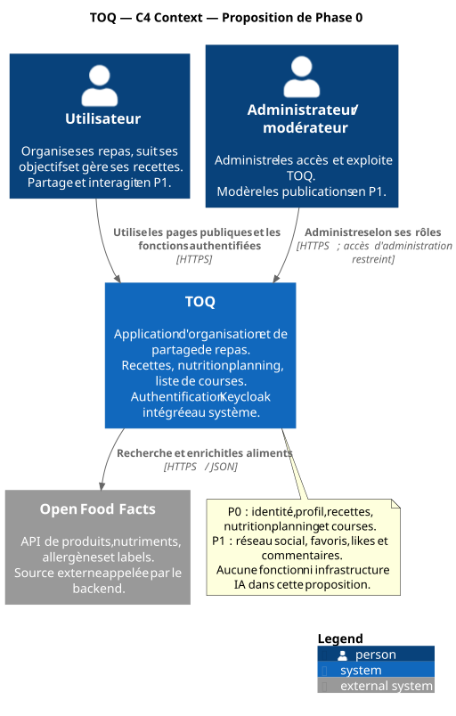
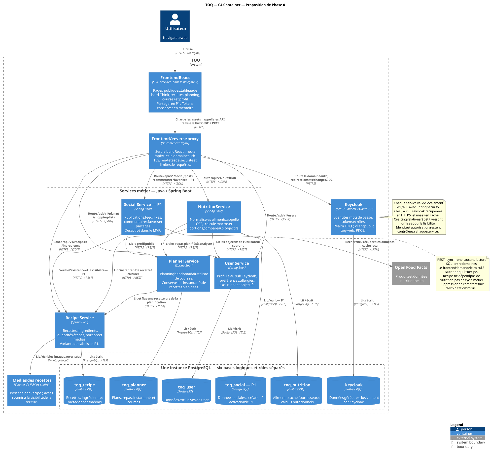
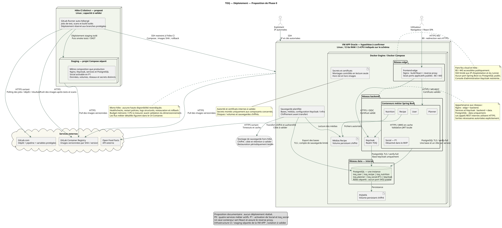

# TOQ — Proposition d’architecture, phase 0

Date de proposition : 22 septembre 2026. **Statut : architecture validée par l’utilisateur.**

Mise à jour du 23 septembre 2026 : la Phase 1 est autorisée, avec une infrastructure exclusivement locale. Oracle Cloud, staging distant, certificats publics, sauvegardes hors hôte et infrastructure externalisée sont différés. Voir [ADR-013](../adr/0013-developpement-local.md) et [le bilan de Phase 1](../PHASE_1.md). La cible de déploiement distante ci-dessous reste un objectif ultérieur, sans mise en place actuelle.

Ce dossier couvre les neuf livrables demandés. Il ne constitue pas une implémentation : aucun service, frontend, pipeline ou environnement n’est créé ou lancé. Les prescriptions techniques du plan sont reprises comme contraintes ; ses instructions d’exécution des phases suivantes ne sont pas déclenchées.

Sources locales, par ordre de priorité : la demande utilisateur, [le plan technique](../../base/PLAN_TECHNIQUE_TOQ_GPT6_ASTRA.md), [le ZIP graphique](../../base/Charte%20graphique-20260922T132420Z-1-001.zip), puis [le schéma fonctionnel](../../base/Sans-titre-2026-09-22-1533.png). Le Markdown arbitre les contradictions entre documents. Les choix supplémentaires ci-dessous restent des propositions.

## 1. Synthèse de compréhension

TOQ organise les repas, calcule leurs apports nutritionnels, produit les courses nécessaires et permet ensuite de partager les recettes. Le parcours MVP est : connexion → préférences et objectifs → création d’une recette et enrichissement des ingrédients → calcul des macros → planification → liste de courses consolidée.

La cible comprend **cinq services métier Java/Spring Boot**, dont **quatre actifs dans le MVP** : User, Recipe, Nutrition et Planner. Social arrive en P1, conformément au plan. Keycloak gère les identités. React fournit une interface simple. PostgreSQL héberge une base distincte par service dans une seule instance. Docker Compose orchestre les conteneurs ; GitLab CI/CD utilise un Runner auto-hébergé.

Les échanges sont REST synchrones. Un Nginx sert le frontend compilé et route les API. Aucun besoin identifié ne justifie Kubernetes/K3s, un bus de messages, Redis, une gateway Java supplémentaire ou un service séparé pour les courses. Les éléments IA, LLM, Ollama et serveur IA de l’image sont entièrement exclus de la cible. Strava et le ranking restent des extensions P2, sans conteneur ni dépendance initiale.

**Périmètre produit proposé :** recettes privées en P0 ; partage explicite en P1. Think affiche les apports **prévus** à partir du planning. Un suivi de consommation réelle demanderait un journal ou une confirmation de repas et reste à valider. L’import MVP désigne l’enrichissement d’aliments via OpenFoodFacts ; l’import d’une recette depuis une URL quelconque nécessite un fournisseur et un contrat supplémentaires.

### Traduction du schéma fonctionnel

| Route React | Page et contenu | Phase |
|---|---|---|
| `/` | Présentation de TOQ, aide, connexion | P0 |
| `/login` | Déclenche la redirection vers Keycloak | P0 |
| `/dashboard` | Résumé du jour, prochains repas, accès rapides | P0 |
| `/think` | Objectifs, calories et macros prévisionnelles | P0 |
| `/planning` | Semaine, créneaux, portions, ajout de recettes | P0 |
| `/planning/shopping-list` | Courses classées par catégorie, cases à cocher | P0 |
| `/recipes`, `/recipes/new`, `/recipes/:id` | Catalogue personnel, création, détail et modification | P0 |
| `/profile`, `/settings` | Profil, allergies, préférences et paramètres | P0 |
| `/social` | Publications, likes, commentaires, favoris, partage | P1 |

La navigation connectée reprend **Accueil, Think, Planning, Recettes, Partager**, avec Profil et Paramètres en bas. « Partager » apparaît lorsque P1 est disponible. Les maquettes de connexion servent à personnaliser le thème Keycloak : TOQ ne collecte pas les mots de passe dans un formulaire React.

### Ce que contient réellement la charte

Le ZIP contient **26 PNG**, et son extraction présente dans `base/` correspond aux 26 entrées, vérifiées par SHA-256 : 7 maquettes dans `Pages TOQ`, 17 fichiers dans `assets TOQi` (une planche de 16 poses et 16 captures), 1 logo et 1 planche promotionnelle. Aucun PDF de charte, SVG, fichier de police ou palette codifiée n’est fourni. Tous les PNG sont opaques, sans pixel transparent.

| Élément | Source sous `base/Charte graphique-20260922T132420Z-1-001/Charte graphique/` | Utilisation prévue |
|---|---|---|
| Logo TOQ | `Logos/ChatGPT Image 21 sept. 2026, 16_06_32.png` | Landing, navigation, thème Keycloak |
| Mascotte TOQi | `assets TOQi/ChatGPT Image 21 sept. 2026, 15_06_05.png` et captures individuelles | Accueil, états vides, aides et confirmations |
| Maquettes | Les 7 PNG de `Pages TOQ/` | Référence de composition pour les composants React |
| Scènes promotionnelles | `Publications/ChatGPT Image 21 sept. 2026, 15_05_24.png` | Illustration éventuelle de la landing |

L’identité observée associe vert forêt, vert feuille, fond crème, cartes arrondies et accents pastel. **Palette de travail proposée, non extraite comme norme officielle :** principal `#145B43`, action `#287A4B`, fond `#FAF7EC`, surface `#FFFDF6`, texte `#183D31`, accent `#E9BD68`. Les contrastes seront vérifiés lors de l’intégration. Une pile de polices système sans-serif suffit initialement ; aucune police de marque n’est identifiée.

Les écrans seront reconstruits avec texte, formulaires et composants accessibles. Les captures ne sont pas des pages prêtes à intégrer. La mascotte sera utilisée comme illustration avec messages déterministes. Les exports du logo et des poses devront être préparés pour leurs fonds et dimensions ; aucun asset n’a été retouché pendant cette phase. Le responsive mobile reste à concevoir.

Le slogan doit être arbitré : le logo indique « Think • Organize • Quick » tandis que plusieurs maquettes emploient « Think / Order / Cook ». Les textes flous, la notification Windows visible sur une maquette, « Tarifs » et « Optimisation » ne deviennent pas des fonctionnalités à réaliser par simple présence dans les images.

## 2. Microservices et responsabilités

| Service | Responsabilité et source de vérité | Base | Dépendances métier sortantes |
|---|---|---|---|
| **User** | Profil TOQ lié au `sub` Keycloak ; préférences, allergies, exclusions, objectifs et paramètres | `toq_user` | Aucune pour les parcours courants |
| **Recipe** | Recettes, portions, étapes, références d’ingrédients, quantités/unités, médias ; visibilité, tags et variantes P1 | `toq_recipe` | Aucune pour les parcours courants |
| **Nutrition** | Données alimentaires, fournisseur OpenFoodFacts, conversions nutritionnelles, calcul par recette/portion, comparaison aux objectifs, règles de labels | `toq_nutrition` | Recipe, Planner, User, OpenFoodFacts |
| **Planner** | Planning hebdomadaire, repas, portions prévues, instantanés de recettes, génération et état des courses | `toq_planner` | Recipe |
| **Social — P1** | Publications, feed, likes, commentaires, favoris et partages | `toq_social` | Recipe, profil public minimal de User |

**Composants techniques :** Keycloak et sa base `keycloak` ; React ; Nginx ; PostgreSQL ; Runner GitLab. Ils ne constituent pas de nouveaux domaines métier. Les migrations applicatives sont gérées par Flyway, service par service. Le schéma Keycloak reste géré par Keycloak.

**Frontière Recipe/Nutrition :** Recipe possède la composition de la recette et les identifiants des aliments associés. Nutrition possède les valeurs des aliments et les résultats calculés. Pour afficher les macros, React appelle Nutrition ; Nutrition lit un instantané de Recipe sous les droits de l’utilisateur puis calcule. Recipe n’appelle pas Nutrition. Une référence alimentaire absente ou invalide produit un calcul incomplet, jamais une valeur inventée.

**Frontière Recipe/Planner :** à l’ajout d’un repas, Planner récupère la recette autorisée avec sa version, ses ingrédients et ses portions de référence. Il conserve cet instantané métier. Une modification ultérieure de la recette ne change pas les courses silencieusement : la synchronisation du repas est explicite.

**Frontière User/Nutrition :** les objectifs sont modifiés uniquement dans User. Pour Think, Nutrition lit les objectifs et les instantanés des repas de Planner ; il renvoie les totaux prévus et leur comparaison. Le dashboard compose ces réponses dans React, sans nouveau service d’agrégation.

**Résilience :** sauvegarder une recette, organiser une semaine et générer les courses ne nécessitent pas une réponse OpenFoodFacts. Nutrition conserve un cache PostgreSQL, applique des délais d’attente et des tentatives limitées sur lectures sûres ; il signale les données manquantes ou périmées. Aucune transaction distribuée ni écriture directe dans une autre base.

## 3. C4 Context



Source modifiable : [c4-context.puml](c4-context.puml).

Le système TOQ inclut l’authentification Keycloak opérée par l’équipe. L’utilisateur organise ses repas et, en P1, partage ses recettes. L’administrateur exploite TOQ et gère les accès. OpenFoodFacts est le fournisseur externe de données alimentaires appelé depuis le backend. GitLab et les sauvegardes relèvent du déploiement, représenté au niveau suivant approprié.

## 4. C4 Container



Source modifiable : [c4-container.puml](c4-container.puml).

Le conteneur C4 « React SPA » désigne l’application exécutée dans le navigateur ; il n’implique pas un serveur Node en production. Son build est servi par le conteneur Docker **frontend-edge**, qui assure aussi le reverse proxy Nginx. Les six bases logiques dessinées résident sur **une seule instance PostgreSQL**, avec comptes et droits distincts. `toq_social` n’est nécessaire qu’en P1.

Les relations métiers courantes sont orientées : Nutrition → User/Recipe/Planner ; Planner → Recipe ; Social → Recipe/User. Les lectures d’un autre service passent toujours par REST. Les échanges administratifs de suppression de compte, rares et distincts de ces parcours, sont décrits dans le contrat de cycle de vie ci-dessous.

### Authentification et autorisations

Realm `TOQ`, client public `toq-web`, rôles `USER`, `MODERATOR`, `ADMIN`. Proposition : un audience backend `toq-api` partagée pour cette application, configurée explicitement dans Keycloak et validée dans chacun des services. Les appels REST internes à l’initiative d’un utilisateur transmettent son access token uniquement aux services TOQ de confiance ; ils refont les contrôles de propriétaire et de visibilité.

React utilise Authorization Code + PKCE S256 ; les tokens restent en mémoire, les origines et redirections sont explicites, sans secret client dans le navigateur. Ce fonctionnement correspond à l’[adaptateur JavaScript Keycloak](https://www.keycloak.org/securing-apps/javascript-adapter).

Chaque backend est un Spring Security OAuth2 Resource Server : validation de signature, `iss`, `aud`, `exp`, `nbf`, puis rôles et ownership. Les clés publiques JWKS sont mises en cache ; il n’y a pas d’introspection Keycloak obligatoire à chaque requête. Le `sub` est une chaîne opaque. L’ID propriétaire vient du JWT, jamais d’un champ `ownerId` fourni par le navigateur. La validation des JWT et de leur audience est documentée par [Spring Security](https://docs.spring.io/spring-security/reference/servlet/oauth2/resource-server/jwt.html).

Le rôle `MODERATOR` donne des pouvoirs explicites sur le contenu social, pas un droit général de lecture des allergies ou des plannings. Les accès aux médias suivent la visibilité de la recette ; le répertoire d’uploads n’est pas exposé comme dossier public.

## 5. Deployment Diagram



Source modifiable : [deployment.puml](deployment.puml).

### Topologie proposée

Un hôte Linux APP exécute Docker Compose : `frontend-edge`, Keycloak, PostgreSQL et les quatre services P0, soit **sept conteneurs applicatifs/techniques permanents**. Social porte ce total à huit en P1. Le schéma initial suggère Oracle et 12 Go RAM / 2 vCPU ; cette capacité et son architecture CPU sont des hypothèses à confirmer, pas un inventaire effectué sur le cloud.

Une enveloppe de départ à mesurer serait : 768 Mio par service métier, 1 Gio pour Keycloak, 1,5 Gio pour PostgreSQL, 256 Mio pour Nginx et 1,5 Gio pour OS/Docker, soit environ 7,25 Gio en P0 et 8 Gio en P1. Ce sont des budgets de conteneurs indicatifs, pas des valeurs `-Xmx` ni des performances garanties. Les JVM doivent conserver de la marge hors heap. Deux vCPU imposent de limiter la concurrence ; les builds, scans et tests lourds s’exécutent sur l’hôte CI.

Le **Runner auto-hébergé est proposé sur une autre machine** que la production. Le staging dispose d’une instance Compose séparée, éventuellement sur cet hôte CI avec ressources encadrées, données de démonstration, secrets et réseaux distincts. Ce placement n’est valable que si les ressources sont disponibles ; on ne suppose pas l’existence de machines supplémentaires. Un hébergement commun avec production demanderait un arbitrage explicite et des limites mesurées.

| Réseau / exposition | Membres et règle |
|---|---|
| `edge` | Nginx ; seuls `443/tcp` et `80/tcp` de redirection sont publics |
| `backend` | Nginx, Keycloak et services ; ports applicatifs non publiés sur l’hôte |
| `data` | PostgreSQL, Keycloak et services autorisés ; réseau interne, jamais de port 5432 public |
| Administration | SSH autorisé seulement aux IP administrateurs et Runner ; console Keycloak et endpoints de gestion restreints |
| Sorties | Nutrition vers OpenFoodFacts en HTTPS ; accès registry/CI et certificats selon besoins explicites |

Un réseau Compose `internal` sans passerelle de sortie ne peut pas porter seul l’appel OpenFoodFacts : Nutrition doit disposer d’une route sortante autorisée. L’isolation réseau limite les accès mais **ne chiffre pas le trafic**.

La proposition production couvre donc HTTPS public, HTTPS entre Nginx/Keycloak/services et entre services, ainsi que TLS PostgreSQL avec vérification du certificat et du nom de serveur. Une CA interne simple et des certificats montés en lecture seule suffisent ; aucun service mesh n’est proposé. Il faut documenter émission, confiance et renouvellement. PostgreSQL peut imposer TLS via `hostssl`, avec une politique rejetant les connexions en clair ; voir la [documentation PostgreSQL SSL](https://www.postgresql.org/docs/current/ssl-tcp.html). Une éventuelle simplification locale HTTP restera limitée au développement et explicitement séparée de la production.

Exemples de domaines à remplacer : `toq.example.invalid` pour React/API et `auth.toq.example.invalid` pour Keycloak. L’issuer public reste identique dans le navigateur et les JWT validés par les services ; l’URL JWKS interne peut être configurée séparément sans désactiver la validation de l’issuer. Cloudflare n’est pas une dépendance initiale.

### Livraison, sécurité et exploitation

Pipeline cible : **validation → tests unitaires/intégration → SAST, dépendances et secrets → build → scan d’images → registry → staging → smoke tests → production → vérification**. Les jobs dépendants attendent les résultats précédents.

| Événement | Exécution proposée |
|---|---|
| Merge Request | Lint, tests, scans et vérification des builds ; aucun secret de production |
| Merge sur `develop` | Images taguées par SHA, publication, staging automatique et smoke tests |
| Merge sur `main` protégée | Images versionnées, déploiement production et healthchecks ; promotion conditionnée aux validations précédentes |

Images identifiées par SHA/version et, pour déployer, digest enregistré ; aucun déploiement fondé uniquement sur `latest`. Les accès production utilisent un Runner/job protégé et un compte de déploiement dédié. Les pipelines non fiables ne reçoivent ni ses secrets ni un accès à son démon Docker. GitLab est contacté par le Runner en HTTPS sortant ; le registre héberge les images, les hôtes les tirent.

Outils proposés : Gitleaks, Trivy, audit Java et `npm audit`, SAST approuvé par l’équipe enseignante (SonarQube si une instance séparée est disponible, sinon outil validé exécuté en CI), DAST ZAP sur staging si réalisable. Les scans ne nécessitent pas une stack permanente lourde sur APP. Les versions exactes et règles de blocage seront figées au bootstrap après vérification de compatibilité et des correctifs disponibles.

Le retour à l’image précédente est associé à des migrations compatibles avec les versions voisines. Une migration destructive demande une procédure particulière ; revenir à une image ne remet pas automatiquement la base dans son état antérieur.

Secrets de développement hors Git ; variables GitLab protégées et masquées ; fichiers de secrets production restreints et montés dans les conteneurs. Les mécanismes Compose de montage de secrets ne remplacent pas le chiffrement du stockage. Disque/volume hôte chiffré pour PostgreSQL, médias et secrets ; méthode concrète Oracle ou LUKS à valider. Sauvegardes chiffrées hors hôte, clés conservées séparément, restauration testée incluant toutes les bases dont Keycloak, médias et configuration.

Cible de sauvegarde proposée : quotidienne, rétention de 7 quotidiennes et 4 hebdomadaires ; RPO de 24 h et objectif RTO de 4 h à **valider puis mesurer**, sans engagement de disponibilité prématuré. Une copie de volume laissée sur le même hôte ne constitue pas la sauvegarde hors hôte attendue.

Socle exploitation : healthchecks, restart policies, logs structurés avec identifiant de corrélation, rotation des logs, suivi disque/mémoire et procédure de restauration. `/actuator/health` et les métriques restent internes. Prometheus/Grafana/Loki sont une évolution conditionnée aux ressources. L’hôte APP et PostgreSQL restent des points uniques de panne acceptés pour cette proposition pédagogique ; aucune haute disponibilité n’est annoncée.

Socle applicatif : DTO et Bean Validation, requêtes paramétrées, erreurs sans stack trace publique, CSP et en-têtes de sécurité, HSTS en production, limites de requêtes et d’uploads, validation réelle des formats d’image, secrets/tokens exclus des logs. Un upload n’est pas autorisé sur la seule base de son extension ou du MIME déclaré par le navigateur.

## 6. Modèle de données initial par service

Notation : `PK` clé primaire, `FK` clé étrangère **locale**, `UQ` unicité, `?` nullable. Les identifiants métier sont UUID, les quantités et nutriments `NUMERIC`/`BigDecimal`, les instants UTC `timestamptz`, les dates de repas locales `date`. `owner_sub`/`author_sub` sont des chaînes opaques du realm TOQ. Les relations vers un autre service sont des références sans FK SQL distante.

Chaque base a son rôle propre ; les droits de connexion et de lecture des autres bases sont révoqués. Aucun service ne se connecte avec le superutilisateur PostgreSQL. Horodatages et version de concurrence sont ajoutés aux agrégats modifiables.

### User — `toq_user`

| Entité | Champs initiaux significatifs |
|---|---|
| `UserProfile` | `id PK`, `keycloak_sub UQ`, `display_name`, `timezone`, `locale`, `status`, `version`, `created_at`, `updated_at` |
| `DietaryPreference` | `profile_id FK`, `code`, PK composite |
| `Allergy` | `profile_id FK`, `allergen_code`, PK composite |
| `ExcludedIngredient` | `profile_id FK`, `ingredient_reference_id` externe Recipe, PK composite |
| `NutritionGoal` | `id PK`, `profile_id FK`, `valid_from`, `valid_to?`, `kcal`, `protein_g`, `carbohydrate_g`, `fat_g`, `version` |
| `AccountDeletionRequest` | `id PK`, `subject`, `status`, `steps JSONB`, `requested_at`, `last_attempt_at?`, `completed_at?` |

Un profil possède plusieurs préférences/allergies/exclusions et un historique d’objectifs. Les intervalles d’objectifs ne se chevauchent pas. Les cibles sont positives ou nulles selon le nutriment, sans calcul automatique de besoins individuels. L’email et les mots de passe restent dans Keycloak ; l’email n’est pas dupliqué par défaut.

### Recipe — `toq_recipe`

| Entité | Champs initiaux significatifs |
|---|---|
| `Recipe` | `id PK`, `owner_sub`, `title`, `description?`, `base_servings`, `visibility`, `status`, `version`, `parent_recipe_id? FK` en P1 |
| `IngredientReference` | `id PK`, `canonical_name`, `category`, `state` (cru/cuit/autre), `active` |
| `RecipeIngredient` | `id PK`, `recipe_id FK`, `ingredient_reference_id FK`, `food_record_id?` externe Nutrition, `quantity`, `unit`, `measured_mass_g?`, `position` |
| `RecipeStep` | `id PK`, `recipe_id FK`, `position`, `instruction` ; UQ `(recipe_id, position)` |
| `Allergen` | `code PK`, `display_name` : vocabulaire de référence |
| `RecipeAllergen` | `recipe_id FK`, `allergen_code FK`, `state`, `source` : déclarations explicites de l’auteur |
| `RecipeMedia` | `id PK`, `recipe_id FK`, `storage_key`, `mime_type`, `byte_size`, `checksum`, `alt_text?` |
| `Tag`, `RecipeTag` — P1 | Référentiel de tags et relation N–N |
| `Label`, `RecipeLabel` — P1 | Code et attribution éditoriale déclarée ; origine explicite |

Une recette possède N ingrédients, N étapes et N médias. `base_servings > 0`, `quantity > 0`, unités contrôlées. L’association `food_record_id` distingue l’ingrédient culinaire canonique du produit/source nutritionnelle. Un produit de marque ne devient pas automatiquement interchangeable avec tout produit portant un nom proche.

L’initialisation des ingrédients canoniques se fait via un petit référentiel contrôlé ; aucun service catalogue supplémentaire. Une variante utilise un `parent_recipe_id`, suffisant avant d’introduire une table `RecipeVariation` plus riche. Une recette est privée par défaut. L’archivage la retire du catalogue mais ne modifie pas les instantanés de planning déjà détenus.

### Nutrition — `toq_nutrition`

| Entité | Champs initiaux significatifs |
|---|---|
| `FoodRecord` | `id PK`, `provider` (`OFF` ou `MANUAL`), `external_id?`, `owner_sub?`, `name`, `basis_quantity`, `basis_unit`, `revision`, `fetched_at?`, `expires_at?` |
| `NutrientProfile` | `food_id PK/FK`, `energy_kcal?`, `protein_g?`, `carbohydrate_g?`, `fat_g?`, `fiber_g?`, `sugars_g?`, `salt_g?` |
| `FoodConversion` | `id PK`, `food_id FK`, `kind` (densité/masse par pièce), `value`, `unit`, `source`, `revision` |
| `FoodAllergen` | `food_id FK`, `allergen_code`, `state` (`PRESENT`, `TRACE`, `ABSENT_DECLARED`, `UNKNOWN`), `source` |
| `CalculationCache` | `id PK`, `owner_sub`, `source_kind`, `source_id`, `source_version`, `input_hash UQ`, `food_revisions JSONB`, `calculator_version`, `result JSONB`, `completeness`, `calculated_at` |
| `LabelRule` — P1 | `code`, `rule_version`, `definition`, `active` ; UQ `(code, rule_version)` |

UQ `(provider, external_id)` pour les produits externes. Un aliment saisi manuellement est privé et rattaché au sujet ; un résultat public futur devra embarquer des valeurs explicitement partageables, sans rendre tout le catalogue personnel public. La base de référence nutritionnelle est explicite : typiquement 100 g ou 100 ml, jamais une supposition implicite.

Le cache est dérivé et reconstruisible ; il ne devient pas propriétaire de la recette ni du planning. Toute réponse depuis ce cache exige une vérification actuelle des droits sur la source et sur les aliments privés référencés. Sa clé inclut la version de recette ou du planning, les quantités, les révisions alimentaires et la version du calculateur. La comparaison aux objectifs est recalculée après lecture du cache d’apports, avec les objectifs et dates d’effet courants lus dans User ; modifier un objectif ne laisse donc pas une ancienne comparaison en cache. En P1, les labels calculés restent dans ces résultats, séparés des labels déclarés dans Recipe.

### Planner — `toq_planner`

| Entité | Champs initiaux significatifs |
|---|---|
| `WeekPlan` | `id PK`, `owner_sub`, `week_start`, `timezone`, `version` ; UQ `(owner_sub, week_start)` |
| `PlannedMeal` | `id PK`, `plan_id FK`, `meal_date`, `slot`, `recipe_id` externe, `recipe_version`, `portions`, `recipe_snapshot JSONB`, `version` |
| `ShoppingList` | `id PK`, `plan_id FK UQ`, `source_plan_version`, `generated_at`, `version` |
| `ShoppingItem` | `id PK`, `list_id FK`, `aggregation_key`, `ingredient_reference_id` externe, `label_snapshot`, `category`, `quantity`, `unit`, `checked` ; UQ `(list_id, aggregation_key)` |

`MealSlot` est initialement une enum (`BREAKFAST`, `LUNCH`, `DINNER`, `SNACK`), sans table dédiée. Une semaine commence le lundi ; le fuseau du profil initialise celui du planning. Plusieurs recettes peuvent partager un créneau. Le repas doit appartenir aux dates de sa semaine et `portions > 0`.

L’instantané est un DTO métier validé, avec version de format : titre, portions de base, ingrédients canoniques, références alimentaires et mesures nécessaires. Il ne contient ni profil privé ni copie brute d’une réponse HTTP. Les nutriments sont recalculés par Nutrition depuis ces ingrédients ; une actualisation du fournisseur peut donc faire évoluer une estimation, avec date et provenance affichées. Figer des apports réellement consommés relève d’une évolution du modèle.

### Social — `toq_social`, P1

| Entité | Champs initiaux significatifs |
|---|---|
| `Post` | `id PK`, `author_sub`, `recipe_id` externe, `text?`, `status`, `created_at`, `updated_at` |
| `PostLike` | `post_id FK`, `actor_sub`, `created_at` ; PK composite |
| `Comment` | `id PK`, `post_id FK`, `author_sub`, `body`, `status`, horodatages |
| `Favorite` | `actor_sub`, `recipe_id` externe, `created_at` ; PK composite |
| `Share` | `id PK`, `post_id FK`, `actor_sub`, `created_at` ; repartage interne seulement si validé |

Les seules références aux autres domaines sont les identifiants. Aucun ingrédient, profil nutritionnel ou mot de passe n’est copié dans Social. À la publication, Social vérifie la propriété et la visibilité partageable de la recette. Lors des lectures, une recette redevenue privée ou supprimée n’est plus exposée par le feed, les commentaires ou les favoris. La première version peut hydrater ces références par lectures REST groupées.

### Invariants de calcul et de cycle de vie

1. **Portions :** quantité nécessaire = quantité de la recette × portions planifiées / portions de base. Exemple : 300 g pour 2 portions deviennent 450 g pour 3 portions.
2. **Nutrition :** valeur = quantité compatible / quantité de référence × nutriment de référence. Les sommes utilisent `BigDecimal`, avec arrondi final documenté. Une valeur inconnue reste `null` ; réponse `COMPLETE`, `PARTIAL` ou `UNKNOWN`, avec la liste des données manquantes. Un total partiel est identifié comme tel.
3. **Unités :** g/kg et ml/l sont convertibles ; g/ml exige une densité connue, pièce/g une masse connue. Un poids mesuré pour la ligne prime sur une conversion générique. En l’absence de conversion, les courses gardent des lignes distinctes.
4. **Regroupement :** ingrédient canonique + état/variante pertinente + dimension compatible, avec produit spécifique conservé si la substitution est interdite. Pas de fusion sur le seul texte du libellé. Exemple compatible : 300 g + 500 g de tomate = 800 g.
5. **Courses :** génération transactionnelle à partir d’une version du planning. Si le planning change, la liste est signalée périmée. La régénération remplace les lignes dérivées sans doublons ; une case cochée est conservée seulement si la clé et la quantité n’ont pas changé, sinon réinitialisée.
6. **Allergènes et labels :** absence d’information ≠ absence d’allergène. Distinguer présence, traces, absence déclarée et inconnu. Les éventuels labels calculés utilisent des règles versionnées et testées ; les seuils ne sont pas inventés à partir des dessins.
7. **Suppression de compte :** User persiste la demande, désactive l’identité et révoque les sessions, puis pilote des suppressions/anonymisations idempotentes via les API internes des services. Un traitement repris après échec suffit, sans bus. Avant la purge, chaque service pose un marqueur technique local `SubjectAccessBlock(subject PK, blocked_at, retain_until)` et confirme sa persistance. Il refuse les anciens tokens du sujet ; la fin de session seule n’annule pas un JWT déjà émis. Le marqueur survit à la purge métier, jusqu’à la fin du traitement et au minimum jusqu’à expiration de tous les access tokens précédents, marge d’horloge comprise. Une propagation partielle entraîne une reprise et n’est pas annoncée comme suppression terminée. L’identité Keycloak et le profil sont supprimés après le traitement. La conservation des recettes publiées et des instantanés détenus par d’autres comptes doit être tranchée avant d’activer le partage. Un journal minimal d’effacements est conservé chiffré indépendamment du jeu de sauvegarde restaurable, pendant une durée couvrant sa rétention ; une restauration rejoue ces effacements avant remise en service. Ce journal ne contient pas de copie du profil supprimé.

## 7. Principaux endpoints REST

Toutes les routes métier ci-dessous commencent par `/api/v1`. Authentification requise, sauf landing et endpoints OIDC propres à Keycloak. Les rôles ne remplacent pas la vérification d’accès aux objets. `me` est toujours résolu depuis le JWT. Les routes internes et Actuator ne sont pas routées par Nginx vers Internet.

| Service | Méthode et chemin après `/api/v1` | Effet principal |
|---|---|---|
| User | `GET /users/me` | Lire le profil ; `404` avant création |
| User | `PUT /users/me` | Créer ou remplacer son profil, de façon idempotente |
| User | `GET`, `PUT /users/me/preferences` | Préférences, allergies et exclusions |
| User | `GET`, `PUT /users/me/nutrition-goals` | Lire ou définir ses objectifs avec date d’effet |
| User | `DELETE /users/me` | Demander la suppression complète ; `202` et demande persistée |
| User, P1 | `GET /users/{subject}/public-profile` | Uniquement pseudonyme et identifiant public ; aucune donnée alimentaire |
| Recipe | `GET /recipes?query=&page=&size=` | Catalogue personnel ; filtres autorisés |
| Recipe | `POST /recipes` | Créer une recette et ses lignes/étapes dans une transaction |
| Recipe | `GET`, `PUT`, `DELETE /recipes/{id}` | Lire, remplacer ou archiver une recette autorisée |
| Recipe | `GET /ingredients?query=&page=&size=` | Rechercher dans le référentiel culinaire local |
| Recipe | `POST /recipes/{id}/images` | Ajouter un média validé, propriétaire seulement |
| Recipe | `GET`, `DELETE /recipes/{id}/images/{imageId}` | Lire selon visibilité ou supprimer si propriétaire |
| Recipe, P1 | `PUT /recipes/{id}/visibility` | Rendre partageable ou retirer le partage |
| Recipe, P1 | `POST /recipes/{id}/variations` | Créer sa variante d’une recette accessible |
| Recipe, ultérieur | `POST /recipes/imports` | Réservé à un fournisseur de recettes choisi ; non actif en P0 |
| Nutrition | `GET /nutrition/foods?query=&page=&size=` | Rechercher dans les aliments déjà connus de TOQ |
| Nutrition | `GET /nutrition/products/{barcode}` | Récupérer un produit OpenFoodFacts via cache/provider |
| Nutrition | `POST /nutrition/foods` | Saisie manuelle privée d’un aliment et de ses nutriments |
| Nutrition | `GET /nutrition/recipes/{recipeId}` | Composition autorisée → totaux, par portion, complétude et provenance |
| Nutrition | `GET /nutrition/me/summary?from=YYYY-MM-DD&to=YYYY-MM-DD` | Planning + objectifs → comparaison des apports prévus ; intervalle borné |
| Planner | `GET`, `PUT /plans/{weekStart}` | Lire/créer le planning de la semaine, date du lundi |
| Planner | `POST /plans/{weekStart}/meals` | Ajouter un repas avec `recipeId`, `date`, `slot`, `portions` |
| Planner | `PATCH`, `DELETE /plans/{weekStart}/meals/{mealId}` | Changer date/créneau/portions ou retirer le repas |
| Planner | `POST /plans/{weekStart}/meals/{mealId}/refresh` | Reprendre explicitement la version actuelle de la recette |
| Planner | `GET /plans/{weekStart}/shopping-list` | Lire la liste et son état de fraîcheur |
| Planner | `POST /plans/{weekStart}/shopping-list` | Générer/régénérer pour une version du planning |
| Planner | `PATCH /shopping-lists/{listId}/items/{itemId}` | Cocher/décocher une ligne appartenant à l’utilisateur |
| Social, P1 | `GET /social/feed?cursor=&limit=` | Feed paginé |
| Social, P1 | `POST /posts` ; `GET`, `DELETE /posts/{id}` | Publier, lire ou retirer une publication |
| Social, P1 | `PUT`, `DELETE /posts/{id}/likes/me` | Like idempotent et retrait |
| Social, P1 | `GET`, `POST /posts/{id}/comments` | Lire/ajouter des commentaires |
| Social, P1 | `PATCH`, `DELETE /comments/{id}` | Modifier son texte ; retirer selon droits auteur/modération |
| Social, P1 | `GET /favorites` ; `PUT`, `DELETE /favorites/{recipeId}` | Favoris personnels |
| Social, P1 | `POST /posts/{id}/shares` | Repartage interne, si ce comportement est validé |

Le `PUT /likes/me` proposé remplace l’exemple `POST /likes` du plan pour exprimer l’idempotence ; les chemins du plan sont des exemples, pas un contrat déjà déployé. Les recettes comportent un tableau d’ingrédients et un tableau d’étapes dans leur DTO : aucun CRUD séparé n’est nécessaire au début.

**Contrats internes principaux :** `GET /internal/v1/recipes/{id}/snapshot` (Recipe, JWT utilisateur), `GET /internal/v1/plans/me/meals?from=&to=` (Planner, instantanés autorisés), `PUT /internal/v1/users/{subject}/access-block` puis `DELETE /internal/v1/users/{subject}/data` (chaque service, blocage et effacement idempotents par un compte technique dédié). Nutrition lit les objectifs via le contrat User existant. Les endpoints internes de lecture refusent aussi les accès illégitimes ; une IP de réseau Docker n’est pas une autorisation. Les API de blocage et d’effacement acceptent uniquement une identité technique avec audience/droit dédiés, jamais le seul rôle utilisateur.

**Conventions de contrat :** DTO versionnés, OpenAPI par service, validation bornée des textes et quantités, pagination par défaut 20/max 100, erreurs `application/problem+json` avec `code` stable et `traceId`. `201` + `Location` après création, `204` après suppression synchrone, `400` sur syntaxe invalide, `401` sans authentification, `403` sur fonction interdite, `404` sur ressource absente/inaccessible, `409`/`412` sur concurrence, `422` sur invariant métier, `429` sur quotas, `503` pour une dépendance indisponible sans repli. Les PUT/PATCH d’agrégats utilisent `ETag`/`If-Match` ; une régénération de courses reçoit la version attendue du planning. Une répétition ne duplique pas les lignes. Les POST créant des repas/publications peuvent accepter une clé d’idempotence bornée dans le temps.

**OpenFoodFacts :** seul Nutrition contacte ce fournisseur via `FoodDataProvider` et `OpenFoodFactsProvider`. Le premier parcours externe à démontrer est la lecture d’un produit par code-barres. Le fournisseur impose un User-Agent et des quotas ; le cache, les délais d’attente et la limitation globale côté backend en tiennent compte. La documentation distingue lecture de produit, recherche structurée et recherche plein texte : un champ `query` TOQ ne sera pas présenté comme une recherche plein texte externe garantie. La version exacte du contrat fournisseur sera figée lors de la phase 4. Voir la [documentation officielle de l’API](https://openfoodfacts.github.io/openfoodfacts-server/api/) et sa [référence de recherche](https://openfoodfacts.github.io/openfoodfacts-server/api/ref-cheatsheet/). Provenance et attribution sont conservées. Les tests utilisent des réponses enregistrées/factices ; la panne du fournisseur et les données absentes font partie des cas obligatoires.

## 8. Arborescence cible du monorepo

Cette arborescence est **proposée**, pas créée par cette phase. `PROJET-5A/` sera la racine du dépôt : pas de répertoire `toq/` supplémentaire nécessaire. Le dossier `base/` fourni reste inchangé.

```text
PROJET-5A/
├── base/                              # Documents sources existants
├── frontend/
│   ├── src/
│   │   ├── app/                       # Routes, layout et authentification
│   │   ├── features/                  # Profil, recettes, think, planning, social
│   │   ├── components/                # Composants réutilisables
│   │   ├── assets/                    # Logo et poses TOQi préparés
│   │   ├── styles/                    # Tokens graphiques et styles
│   │   └── api/                       # Clients des API métier
│   ├── tests/
│   ├── package.json
│   └── Dockerfile                     # Build React puis runtime frontend-edge
├── services/
│   ├── user-service/
│   ├── recipe-service/
│   ├── nutrition-service/
│   ├── planner-service/
│   └── social-service/                # Implémentation activée en phase 6
│       # Chaque service : pom.xml, Maven Wrapper, Dockerfile,
│       # src/main/java/.../{api,application,domain,infrastructure},
│       # src/main/resources/db/migration, src/test/
├── infra/
│   ├── compose/
│   │   ├── compose.dev.yml
│   │   ├── compose.prod.yml
│   │   └── compose.staging.yml         # Surcharge de la topologie production
│   ├── reverse-proxy/                 # Routage, TLS, headers, limites
│   ├── keycloak/                      # Realm sans secrets et thème
│   ├── postgres/                      # Création des bases/rôles et TLS
│   ├── gitlab-runner/                 # Configuration modèle et procédure
│   └── monitoring/                    # Socle ; stack complète optionnelle
├── scripts/
│   ├── backup.sh
│   ├── restore.sh
│   ├── deploy.sh
│   └── smoke-test.sh
├── tests/e2e/
├── docs/
│   ├── architecture/                 # Ce dossier et ses trois diagrammes
│   ├── adr/                          # Décisions proposées puis acceptées
│   ├── api/                          # Contrats/export OpenAPI par service
│   ├── STATUS.md
│   ├── SECURITY.md
│   └── BACKUP_RESTORE.md
├── .gitlab/ci/                        # Jobs découpés par responsabilité
├── .gitlab-ci.yml
├── .env.example                      # Noms de variables, aucune valeur secrète
├── .gitignore
├── Makefile                          # Raccourcis facultatifs
└── README.md
```

Les entités JPA et repositories ne sont pas partagés entre services. Des conventions de build et fixtures de contrats peuvent être communes sans transformer le monorepo en base de données ou domaine partagé. Les branches `feature/* → develop → main` passent par Merge Requests et branches protégées.

## 9. Décisions techniques à valider

Toutes les décisions suivantes sont **proposées**. Les contraintes déjà explicites du plan (React, Java/Spring, PostgreSQL, Keycloak, Compose, GitLab et absence d’accès interbase) sont respectées, sans les rouvrir inutilement. Les ajouts hors socle pédagogique doivent aussi être présentés à l’équipe enseignante.

| ID / portée | Proposition recommandée | Alternative ou conséquence à arbitrer |
|---|---|---|
| ADR-001 — Services | 4 services métier en P0, Social en P1 ; courses dans Planner | Activer Social immédiatement augmente la charge sans servir le MVP prioritaire |
| ADR-002 — Données | Une instance PostgreSQL, une base et un rôle par domaine ; Flyway | Des schémas séparés économisent peu ici et demandent une discipline de droits différente |
| ADR-003 — Edge et web | React SPA ; un Nginx sert le build et route les API ; TypeScript et Vite proposés comme outillage | Un serveur frontend séparé ajoute un conteneur ; choix d’outillage à confirmer avec l’équipe |
| ADR-004 — Sécurité | PKCE, audience `toq-api`, tokens en mémoire ; TLS public et interne, disques et backups chiffrés | Valider CA/certificats, domaines, stockage chiffré et les moyens d’exploitation correspondants |
| ADR-005 — Cohérence métier | Instantanés du planning, mise à jour explicite, données incomplètes visibles | Des liens toujours vivants changeraient les courses dès qu’une recette est modifiée |
| ADR-006 — Infrastructure | APP dédié ; Runner distinct ; staging séparé de production | Confirmer machines, 12 Go/2 vCPU, architecture CPU, stockage et placement staging |
| ADR-007 — Nutrition et import | Apports prévus en P0 ; OFF par code-barres et saisie manuelle ; fournisseur de recettes ultérieur | Confirmer si consommation réelle ou import URL sont réellement exigés dans le MVP |
| ADR-008 — Partage et suppression | Recettes privées P0 ; publication explicite P1 ; suppression reprise après échec | Décider sort des publications, commentaires et instantanés tiers lors d’une suppression de compte |
| ADR-009 — Design | Direction visuelle du ZIP ; palette proposée, police système, composants accessibles | Valider slogan officiel, palette, préparation des exports et comportement mobile |
| ADR-010 — Livraison | MR contrôlées, staging automatique, production après merge protégé ; images immuables et migrations compatibles | Choisir SAST accepté, seuils de scans et éventuelle approbation manuelle de production |
| ADR-011 — Sauvegardes | Stockage hors hôte, chiffrement, restauration mesurée ; proposition RPO 24 h/RTO 4 h | Confirmer destination, rétention, responsabilité des clés et tests de restauration |
| ADR-012 — Versions | Versions supportées et compatibles figées au bootstrap, images et lockfiles reproductibles | Le JDK local ne fixe pas à lui seul les versions serveur ; vérifier contraintes pédagogiques avant de générer les projets |

Le [registre ADR](../adr/README.md) référence ces propositions. Les arbitrages nécessaires avant bootstrap sont surtout ADR-001 à 004, ADR-006 et ADR-012. Les contrats métier de ce dossier doivent être acceptés avant leurs phases d’implémentation respectives.

**Vérification documentaire :** inventaire des trois sources, comparaison du ZIP et de son extraction, revue des frontières de services, des contraintes d’accès et des chemins REST. Les trois fichiers PlantUML sont fournis avec leurs rendus SVG ; syntaxe et rendu ont été vérifiés localement avec PlantUML 1.2026.8 et son moteur Smetana, sans envoyer les schémas à un service de rendu externe. Les vérifications métier à réaliser ensuite couvriront conversions/portions, nutrition incomplète, consolidation de courses, concurrence, accès aux données d’autrui et panne OpenFoodFacts, puis l’E2E connexion → recette → planning → courses. Aucun test applicatif ni test de charge ne peut être annoncé à cette phase.

**Definition of Done de phase 0 :** proposition documentée, diagrammes fournis et **validation utilisateur reçue**. Les mentions « proposé » et « à valider » des sections d’origine conservent l’historique de la proposition ; l’acceptation et les reports effectifs sont suivis dans le registre ADR et [STATUS.md](../STATUS.md). L’implémentation suit désormais les phases autorisées et le périmètre local de l’ADR-013.
